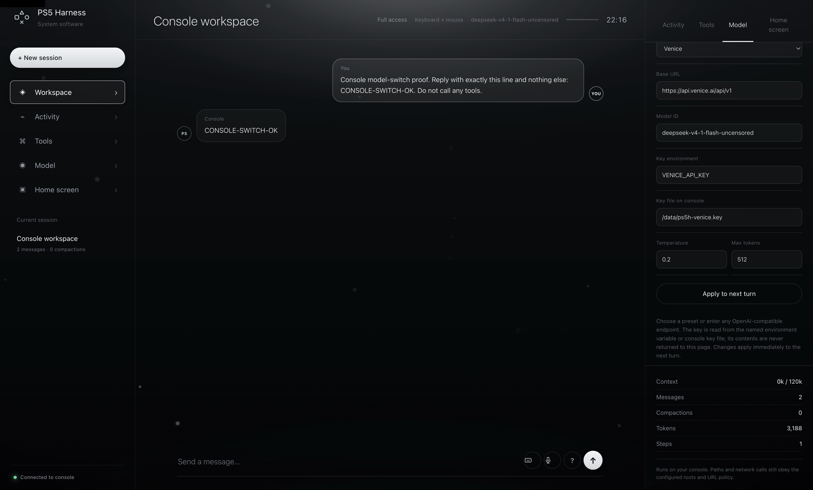
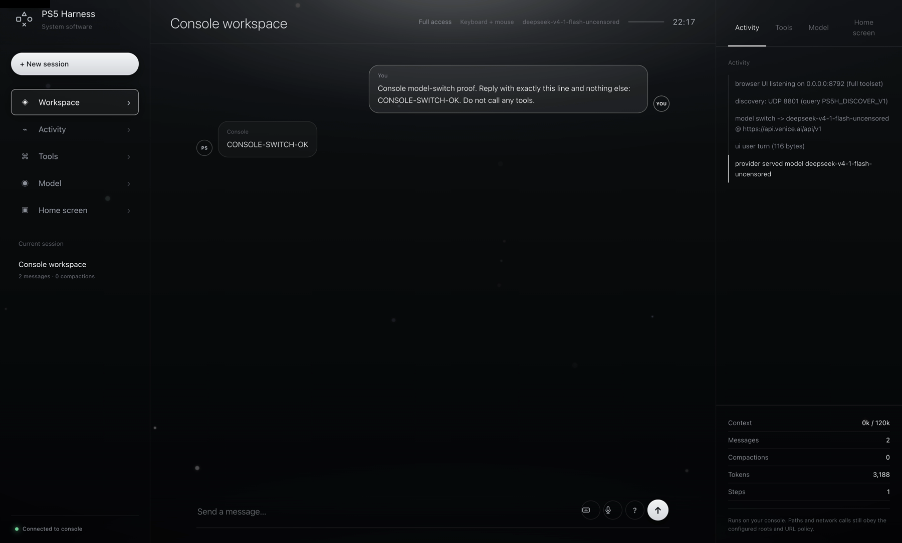

# PS5 Harness

[github.com/0xFlan/ps5-harness](https://github.com/0xFlan/ps5-harness) · MIT

PS5 Harness is a local agent for a jailbroken PlayStation 5. It can run a small
model inside its own process on the console, with no cloud key and no second
app. You can also choose any OpenAI-compatible model and endpoint (a service
that accepts OpenAI-style chat requests). The model can inspect files, use
guarded local tools, load skills (folders of instructions), and send bounded
work to other agents. The harness runs on the console or on a host. It has no
project-operated backend.

Use this software only on a console that you own or have written permission to
test. The example below uses a read-only demonstration root (a folder the agent
can inspect but cannot change).

## Main example

The figure below is a prepared evidence figure. It combines six crops from two
real screenshots: a host transcript and a console Model-panel screenshot. The
two screenshots are separate sessions. It is not one continuous screenshot.

- The top crop is the host request. The user asks the model to load the
  `local-architect` skill and start a two-lane swarm (two child agents running
  together). The swarm should look for ways to carry out a penetration test
  (pen test) of the console. It should also find possible exploit surfaces
  (places where a security weakness might be found).
- A detail strip repeats the key request in three larger crops. It uses the
  same prompt, not a second message.
- The console Model panel crop shows the selected model ID
  `deepseek-v4-1-flash-uncensored`.
- The bottom crop is the host Activity log. It shows tool calls (calls to
  built-in functions): `tool env_info`, `tool skill`, `tool swarm`, `swarm start`,
  and two `delegate` calls. A `delegate` call hands work to a child agent.

The request asks for a read-only run and says not to execute anything.


*Figure 1. Prepared evidence figure. It combines six crops from two real
screenshots. Four come from a host transcript: the prompt and three larger
detail crops. One is a crop of the console Model panel. One is the host
Activity-log crop. The two screenshots are separate sessions, not one
continuous screenshot. The top
crop shows the user's request: load `local-architect`, start a two-lane swarm,
look for ways to pen-test the PS5, and find possible exploit surfaces. The
three detail crops repeat the key words at a larger size so they stay readable
at mobile width. The console Model-panel crop shows the model ID
`deepseek-v4-1-flash-uncensored`. The bottom crop shows the host Activity log
with `tool env_info`, `tool skill`, `tool swarm`, `swarm start`, and two
`delegate` calls. The request asks for a read-only run and says not to execute
anything. The labels and borders are annotations, not host UI. The host
transcript and the console panel are separate screenshots; Figures 2 and 3
show the console UI.*

In the figure, look for these pieces of evidence:

- `tool skill {"name":"local-architect"}` appears before the swarm starts.
- `tool swarm` receives two named lanes, and `swarm start` reports width 2.
- `tool env_info` is a tool call. The two `delegate` calls are tool calls too.
- The model ID `deepseek-v4-1-flash-uncensored` appears in the middle crop.

Plain-language note: this README follows the principles of ISO 24495-1. It
puts the reader first, uses short sentences and common words, and defines
technical terms on first use.

## Who this is for

- PlayStation 5 owners who run homebrew on a console they control.
- Security researchers who test a console with written permission.
- Developers who add tools, endpoints, plugins, skills, or agent profiles.

## Contents

- [Main example](#main-example)
- [What you can do](#what-you-can-do)
- [Terms used in this README](#terms-used-in-this-readme)
- [Quick start on a host](#quick-start-on-a-host)
- [Run the model on the console (no key)](#run-the-model-on-the-console-no-key)
- [Choose a model and endpoint](#choose-a-model-and-endpoint)
- [Start the browser workspace](#start-the-browser-workspace)
- [Run on a PS5](#run-on-a-ps5)
- [Tools](#tools)
- [Skills](#skills)
- [Delegation, swarms, and missions](#delegation-swarms-and-missions)
- [Safety rules](#safety-rules)
- [Configuration reference](#configuration-reference)
- [Build, test, and release](#build-test-and-release)
- [Verification](#verification)
- [Known limits](#known-limits)
- [More documentation](#more-documentation)

## What you can do

- **Run without a cloud key.** Start the built-in llama.cpp model on the
  console. The GGUF and the model runtime are both local; no PS5LM and no key
  are needed. See
  [Run the model on the console](#run-the-model-on-the-console-no-key).
- **Choose a cloud model at runtime.** Open the Model panel and change the
  provider (the service that hosts the model), base URL, model ID, key source,
  temperature, or token limit. Changes apply to the next top-level turn without
  restarting the harness.
- **Inspect the local system.** Read directories, search files, identify
  binaries, inspect headers, read strings, and print a bounded environment
  report.
- **Use local skills.** A skill is a folder of instructions. The model can list
  skills, load one by name, and read a bundled resource. A skill cannot widen
  the configured roots, network policy, secrets, or delegation limits (limits
  on work a parent can hand to a child agent).
- **Delegate and run swarms.** A delegated child gets the parent's tool
  registry, roots, network policy, and shared budget (a shared limit on steps
  and tokens). A swarm runs up to eight child tasks in parallel and preserves
  their order.
- **Run a mission.** A mission is a bounded JSON sequence of single-agent steps
  or swarms. It stops at the first failed step.
- **Use the browser workspace.** The harness serves a token-protected page with
  a chat transcript, live activity, a tool catalogue, a model picker, and
  session history. The page loads no content delivery network, web font, or
  other external file.

## Terms used in this README

| Term | Meaning |
|---|---|
| Harness | The local program that connects a model to tools and a workspace. |
| Runtime | The running harness process. |
| Model | The remote or local language model that produces text and tool calls. |
| Provider | The service that hosts the model endpoint. |
| Capture | A screenshot of the running user interface. |
| Endpoint | The HTTPS base URL that accepts OpenAI-compatible chat requests. |
| Tool | A function that the model can call, such as `fs_read` or `env_info`. |
| Skill | A folder of instructions and optional files that the model can load. |
| Read-only | A run that can inspect data but cannot change files. |
| Budget | The maximum number of steps and tokens a run may use. |
| Penetration test (pen test) | An authorized review that looks for security weaknesses in a system. |
| Exploit surface | A place where a security weakness might be found or used. |
| Swarm | A group of child agents that run at the same time under one budget. |
| Delegation | A parent agent giving a task to a child agent. |
| Reconnaissance (recon) | A read-only look at a system to learn its layout and possible weak points. |
| Mission | A JSON file that lists steps and swarms in a fixed order. |
| Root | A directory that the path guard allows for reads or writes. |
| Key source | An environment variable name or a local file path. The harness reads the key from that source. The page does not receive the key value. |
| Token | A random password that protects the browser API. |
| Manifest | A JSON file that describes an HTTP API and its operations. |
| Plugin | Compiled code that adds a tool to the harness process. |

## Quick start on a host

The core has no PS5 build dependency. It builds on macOS and Linux.

Requirements:

- A C++20 compiler and `make`.
- libcurl and OpenSSL development files.
- A POSIX shell.

Build and test:

```bash
make                  # build/harness
make test             # run the host test suite
make fuzz-run         # sanitizer fuzz runs, 20,000 iterations each
make sanitize-test    # sanitizer runs for recon and mission tests
make plugin-example   # build the example plugin
make tools            # list built-in and manifest tools
./build/harness --resources
```

Start the workspace:

```bash
./build/harness --config config.example.json --serve 8787
# Open the URL printed by the harness.
# The command line prints the token once.
```

Do not expose the LAN listener to the internet. The token is the only
credential. Anyone who has the token can use the tools that the process can
reach.

Useful flags:

| Flag | Effect |
|---|---|
| `--serve-token <token>` | Sets a fixed token of at least 16 characters. Use this for a stable setup. |
| `--session <path>` | Changes the saved-session path. The path must be under the first write root and must not look secret-bearing. |
| `--context-chars <n>` | Sets the transcript budget. The default is 120000 characters; the minimum is 4096. |
| `--discovery-port <n>` | Sets UDP discovery. Use `0` to disable it. |
| `--plan` | Removes mutating tools and makes the run read-only. |
| `--agent <name>` | Uses a local agent profile for the turn. |
| `--agents <dir>` | Sets the profile directory. |
| `--skills <dir>` | Sets the skills directory. |
| `--ui-shot` | Prints one console-driver frame and exits. |
| `--ui-flow <file>` | Runs a bounded console-driver flow file and exits. |

## Run the model on the console (no key)

The harness can run the language model inside its own process on the PS5. You do
not need a cloud API key, a phone, a laptop, a second app, or PS5LM. The GGUF
model file and the harness both run on the console.

This is the shortest supported path. You still use a laptop or phone for the
one-time file transfer and for the browser page; the model itself does not use
them.

### What you need

1. A jailbroken PS5 with `elfldr` listening on port 9021.
2. The harness release bundle. Build it with `make release`, or use the
   `-local.zip` kit described below. The bundle contains `PHAR00001/`.
3. One model file: `Qwen3.5-0.8B-Q4_K_M.gguf` (about 532 MB).

Download the model directly:

- [Qwen3.5-0.8B-Q4_K_M.gguf (Hugging Face, 532 MB)](https://huggingface.co/unsloth/Qwen3.5-0.8B-GGUF/resolve/main/Qwen3.5-0.8B-Q4_K_M.gguf?download=true)
- [Model card and other quantisations](https://huggingface.co/unsloth/Qwen3.5-0.8B-GGUF)

Read the model card for its licence before you redistribute the file.

To make one zip that already contains the harness, the local config and the
model, run:

```bash
make local-kit LOCAL_MODEL=/path/to/Qwen3.5-0.8B-Q4_K_M.gguf
# dist/ps5-harness-<version>-<commit>-local.zip
# dist/ps5-harness-<version>-<commit>-local.zip.sha256
```

### Copy the files

Unzip the bundle. You need the whole `PHAR00001` folder and
`config.console-local.json`.

On the console, create this layout:

```text
/data/homebrew/PHAR00001/harness.elf
/data/homebrew/PHAR00001/models/Qwen3.5-0.8B-Q4_K_M.gguf
/data/ps5h-local.json
```

`config.console-local.json` is the last file. Rename it to `ps5h-local.json`
when you copy it. Its model path is already
`/data/homebrew/PHAR00001/models/Qwen3.5-0.8B-Q4_K_M.gguf`.

A web file manager such as the one often running on port 8888 can copy the
files. Keep the model file name and folder exactly as shown. If you put the
model somewhere else, change `local_model_path` in `ps5h-local.json` to the
real path.

### Start the harness

The launch command passes the config path to the payload. Replace the console
address and the token. Use a token of at least 16 characters.

```bash
printf 'file:/data/homebrew/PHAR00001/harness.elf?args=--config%%20/data/ps5h-local.json%%20--serve%%208787%%20--serve-token%%20<your-long-token>%%20--session%%20/data/homebrew/ps5h-chat.json\n' \
  | nc -w 60 <console-ip> 9021
```

Wait until the console log says:

```text
[local] model bytes 532517120
[harness] local model ready: /data/homebrew/PHAR00001/models/Qwen3.5-0.8B-Q4_K_M.gguf on port 18081
[harness] browser UI listening on 0.0.0.0:8787
```

Then open:

```text
http://<console-ip>:8787/?token=<your-long-token>
```

### Prove that it works

Send this message in the browser:

```text
Call the fs_list tool with arguments {"path":"/data/homebrew"}. Do not write the command as text. Then tell me how many entries were returned.
```

A working console run calls the real tool. The Activity panel shows
`tool fs_list {"path":"/data/homebrew"}`, and the answer uses the real entry
count. A reply with text but no tool call is not proof. If that happens, send
`/api/reset` and try the same message again.

On one test console this took 32.0 seconds for the first cold answer and 14.5
seconds for the tool turn. The first turn is slower because it fills the prompt
cache. A PS5 has a shared, modest CPU; do not expect laptop speed.

### If the model does not start

- Check the model file. The size must be 532,517,120 bytes.
- Check `local_model_path` in `/data/ps5h-local.json`.
- Keep the harness and the model under `/data/homebrew`. The write guard needs
  that root.
- Use 3 threads and a 4096-token context on a base PS5. Larger values use more
  memory and can fail.
- The harness listens on loopback port 18081 for the in-process server. Do not
  start PS5LM on that port. You do not need PS5LM at all.

### How the local path is protected

Local mode is a special in-process case. The harness starts its own llama.cpp
server on `127.0.0.1:18081/v1`, checks that exact loopback address, and sends no
`Authorization` header. The general URL policy is unchanged: ordinary model
endpoints must still be HTTPS, and private or loopback addresses are still
rejected. The local switch has no general-purpose URL override.

See [`docs/LOCAL-MODEL.md`](docs/LOCAL-MODEL.md) for the build and design notes.

## Choose a model and endpoint

The harness can call any OpenAI-compatible HTTPS endpoint, or run its built-in
on-console model. You do not need to edit a config file or restart the process
to change between them.

1. Open **Model** in the left rail or the right panel.
2. Select **On-console (built-in)** to use the GGUF that runs inside the
   harness. No key is needed. Or select a cloud preset: **OpenAI**, **Venice**,
   **OpenRouter**, or **Groq**. Select **Custom endpoint** for any other
   compatible service.
3. Enter the base URL and the exact model ID from your provider.
4. Enter one key source:
   - **Key environment:** the name of an environment variable.
   - **Key file on console:** an absolute path to a local file that contains
     the key.
5. Set temperature and the maximum response tokens, if needed.
6. Select **Apply to next turn**.



*Figure 2. The Model and provider panel on the deployed console. It shows the
selected model `deepseek-v4-1-flash-uncensored` on Venice. The workspace header
and model field show the selected model. The panel sits at the Apply control.
The key source field shows a temporary path, not the key value.*



*Figure 3. The same deployed console browser session after one real Venice
turn. Activity records the switch and `provider served model
deepseek-v4-1-flash-uncensored`. The stats show 3,188 tokens in one step and
the answer `CONSOLE-SWITCH-OK`.*

The model ID used in the screenshot is Venice's
`deepseek-v4-1-flash-uncensored`. Venice lists this model in its model catalogue;
availability and prices can change. Enter the exact ID that your account can
use.

The Model panel has these safeguards:

- The provider URL goes through the same URL policy as a model turn. The default
  policy accepts HTTPS only and rejects private and loopback addresses.
- The harness reads the key on the server. The page receives the key source
  label or path, never the key value.
- The harness refuses a model change while a turn is running.
- The harness logs the model and endpoint, but not the key.

### Model settings in a config file

```json
{
  "model": {
    "base_url": "https://api.venice.ai/api/v1",
    "model": "deepseek-v4-1-flash-uncensored",
    "api_key_env": "VENICE_API_KEY",
    "api_key_file": "",
    "temperature": 0.2,
    "max_tokens": 4096
  }
}
```

Use `api_key_env` when the launcher can set an environment variable. Use
`api_key_file` when it cannot. The file must contain the key as one line. The
config stores only the variable name or the file path.

A key file is a secret. Keep it outside the repository and outside the release
archive. Restrict its permissions. Delete it when you no longer need it.

### What happens to delegated children

The Model panel changes the primary agent for the next top-level turn. Child
agents created by `delegate`, `swarm`, or a mission use the model configuration
that was loaded at startup. Restart the harness after changing the model if you
need older child profiles to use the new model. The current run keeps its
budget accounting and tool permissions.

## Start the browser workspace

```bash
./build/harness --config config.example.json --serve 8787 \
  --session /data/homebrew/ps5h-session.json
```

The page has three areas:

- The left rail starts a session and switches panels.
- The centre shows the chat and the composer.
- The right panel shows Activity, Tools, Model, and Home screen.

The page works on a phone or tablet on the same LAN. It also works with a
keyboard, mouse, game controller, on-screen keyboard, pointer, or browser
dictation. See [Input](#input) and
[HTTPS and microphone trust](#https-and-microphone-trust).

### Input

The page reads the device that runs the browser. Peripherals paired only to the
console are not forwarded to a remote browser.

- **Keyboard and mouse:** type in the composer. Enter sends. Shift+Enter adds a
  line. Tab moves focus. Ctrl/Command+K returns to the composer.
- **Controller:** the Gamepad API maps the D-pad and left stick to focus. Cross
  or A activates. Circle or B goes back. Square or X opens the on-screen
  keyboard. Triangle or Y focuses the composer. L1 and R1 select Activity and
  Tools. The triggers scroll.
- **On-screen keyboard:** letters, digits, punctuation, Shift, Backspace, Space,
  and Enter. Controller focus rings move between keys.
- **Touchpad and pointer:** touch input moves a virtual pointer. A tap or
  touchpad click activates the control under it.
- **Dictation:** the microphone button uses the browser's Web Speech
  recognition, when the browser provides it. The browser uses its selected
  microphone.

Web Speech and microphone permissions need HTTPS or localhost. The console
serves HTTPS on port 8790 and HTTP on ports 8789 and 8791. See
[HTTPS and microphone trust](#https-and-microphone-trust).

### HTTPS and microphone trust

The console can serve the same workspace over HTTP and HTTPS. A typical setup
uses these values:

| Item | Value |
|---|---|
| HTTPS workspace | `https://<console-ip>:8790/` |
| HTTP workspace | `http://<console-ip>:8791/` |
| HTTP companion | `http://<console-ip>:8789/` |
| Certificate | `/data/ps5h-cert.pem` |
| Private key | `/data/ps5h-key.pem` |
| Certificate identity | `CN=PS5 Harness`; Subject Alternative Name (SAN) includes the console address, `127.0.0.1`, and `localhost` |

The certificate is self-signed. Treat it as a local root certificate. Import it
on the browser device and set it to **Always Trust**.

```bash
security add-trusted-cert -r trustRoot \
  -k ~/Library/Keychains/login.keychain-db ps5h-cert.pem
```

On iOS or iPadOS, install the certificate profile, then enable it under
**Settings → General → About → Certificate Trust Settings**.

If the console gets a new network address, use the HTTP listener or make a new
certificate with the new address in its SAN. A browser warning that you click
through is a test workaround, not proof that trust works. HTTPS does not replace
the token.

Start both listeners from one payload:

```bash
./build/harness --config /data/ps5h-mission.json --serve 8791 \
  --serve-tls 8790 --tls-cert /data/ps5h-cert.pem \
  --tls-key /data/ps5h-key.pem --serve-token <token> \
  --session /data/homebrew/ps5h-mission-session.json
```

## Run on a PS5

The shortest console path is the built-in local model. It needs no cloud key.
Follow [Run the model on the console](#run-the-model-on-the-console-no-key).

The release bundle has a validated payload package, `harness.elf`, a local
discovery helper, examples, both console configs, licence notices, and
`START-HERE.md`.

```bash
make release
# dist/ps5-harness-<version>-<commit>.zip
# dist/ps5-harness-<version>-<commit>.zip.sha256

make local-kit LOCAL_MODEL=/path/to/Qwen3.5-0.8B-Q4_K_M.gguf
# dist/ps5-harness-<version>-<commit>-local.zip
# that zip also contains PHAR00001/models/Qwen3.5-0.8B-Q4_K_M.gguf
```

The release build needs the pinned payload SDK, PacBrew libraries, LLVM
toolchain, and the PS5 llama.cpp static archives. Follow
[`platform/ps5/BUILD.md`](platform/ps5/BUILD.md),
[`docs/LOCAL-MODEL.md`](docs/LOCAL-MODEL.md) and
[`docs/RELEASE.md`](docs/RELEASE.md).

For cloud mode, stage `config.console.json` as `/data/ps5h-config.json` and
launch with the same shape:

```bash
printf 'file:/data/homebrew/PHAR00001/harness.elf?args=--config%%20/data/ps5h-config.json%%20--serve%%208787%%20--serve-token%%20<token>\n' \
  | nc -w 30 <console-ip> 9021
```

The payload starts. Open the printed URL or the home-screen tile. Keep the
console and the browser on a trusted LAN.

The harness does not install a background service. If the console reboots or
loses the jailbreak, launch the payload again.

## Tools

The default registry includes guarded file, network, process, and agent tools.
The exact list depends on the mode and installed endpoint or plugin tools.

| Group | Tools | What they do |
|---|---|---|
| Read files | `fs_list`, `fs_read` | List a directory or read a text file inside the read roots. |
| Write files | `fs_write`, `fs_edit`, `fs_mkdir`, `fs_move`, `fs_delete` | Change files inside the write roots. The write guard resolves every path to its real path first. |
| Inspect files | `fs_tree`, `file_info`, `fs_strings`, `fs_search`, `hexdump` | Map a tree, identify a binary, read bounded strings, search text, or print raw bytes. |
| Environment | `env_info`, `sysctl` | Report the build, roots, mounts, CPUs, memory, limits, and selected system values. |
| Network | `http_get`, `download` | Fetch a URL or stream a file through the URL policy. |
| Skills | `skill` | List skills, load instructions, or read a bundled resource. |
| Agents | `delegate`, `swarm` | Send work to another profile or run bounded parallel lanes. |

`--plan` removes every mutating tool from the registry. A model cannot call a
tool that is not in the registry. A refusal is an error, not a suggestion to
find another path.

Every tool call has a deadline. The default is 30 seconds; a tool can set a
different value. A large response is capped by the runtime budget.

### Console driver

The payload has no native window, so the console's screen is the workspace it
serves. The agent can operate that screen from inside the process: it reads a
frame and presses the same buttons the browser's gamepad layer maps. No laptop,
no browser and no second agent is in the loop.

| Tool | What it does |
|---|---|
| `screen_shot` | An ASCII frame of the screen plus the focused control id. |
| `screen_find` | Search controls on every panel by id, label or value. |
| `screen_focus` | Move focus to a control by id, switching panel when needed. |
| `screen_press` | Cross activates, circle goes back, up/down move focus, l1/r1 and left/right switch panel, triangle focuses the composer. |
| `screen_type` | Type into the focused field: the message composer or a model field. |
| `screen_flow` | Run up to 64 steps with expectations. The first mismatch stops it. |

A flow is a JSON list of steps. Each step presses, focuses, types, or asserts
what is visible, so a setup sequence is checked rather than assumed. The example
below switches the provider and fails if the screen does not say so:

```json
{"steps": [
  {"press": "r1"},
  {"expect_panel": "tools"},
  {"focus": "model:id"},
  {"type": "qwen3.5-0.8b"},
  {"focus": "model:apply"},
  {"press": "cross"},
  {"expect_status": "model applied"},
  {"shot": true}
]}
```

```bash
./build/harness --ui-shot                               # one frame, no model
./build/harness --ui-flow examples/flows/panel-tour.json  # run a flow
```

With `--serve` running, every press is a real action. Apply goes through the
same field validation and URL policy as `POST /api/model`, a send runs a turn,
and the home-screen controls call the same tile manager as `/api/home-tile`. A
browser attached to the same process follows the panel the agent opened, and a
panel a person opens is what the agent's next frame shows. Focus is shared the
same way: the page reports the control a person reaches with the controller,
keyboard or click, so the agent's frame reads the panel and control they are on.
The page follows the agent's panel while it is driving; it does not yet mirror
the agent's focus inside a panel. `--plan` removes every pressing tool, so a
read-only run can look but not act.

The driver does not reach the PS5's own system software: a payload gets no
framebuffer capture and no HID injection. It operates the harness surface as the
console's UI. That is why the claim is that the console drives itself, not that
it drives the firmware's menus.

### Local reconnaissance

Four read-only tools answer the question "what machine am I on?":

| Tool | Report |
|---|---|
| `env_info` | Build, platform, current directory, roots, skills directory, CPUs, memory, limits, budget, and mounts. It hides other titles' `/mnt/sandbox/...` mounts. |
| `fs_tree` | A bounded tree under a read root. Symlinks are reported, never followed. Secret-named entries are marked denied. |
| `file_info` | Size, mode, owner, time, sha256, magic, and ELF, Mach-O, or PE headers. |
| `fs_strings` | Up to 200 printable ASCII strings from the first 16 MiB of a file. It does not execute or decompile the file. |

Examples:

```bash
./build/harness --call env_info --args '{}'
./build/harness --call fs_tree --args '{"path":".","depth":2}'
./build/harness --call file_info --args '{"path":"build/harness"}'
./build/harness --call fs_strings --args '{"path":"build/harness","min_length":8}'
```

## Skills

A skill is a local folder of instructions. It is not code and it is not a new
permission.

```text
<skills_dir>/<name>/SKILL.md
```

The default directory is `/data/homebrew/skills` on the console and `skills` on
the host. Set `skills_dir` in the config or use `--skills <dir>`.

`SKILL.md` can start with frontmatter:

```markdown
---
name: console-notes
description: Create, append to, and review notes on the console.
---

# Console notes

1. Read the notes file before changing it.
2. Use fs_edit for a targeted append, or fs_write to create the file.
3. Report the exact path from the tool result.
```

The `skill` tool lists local skills and built-in skills. A disk skill with the
same name overrides the built-in copy. Built-in skills are compiled into the
binary, so a fresh console has methodology without extra files.

Six clean-room skill packs are included. They are instructions only. They do not
contain third-party code, binaries, scripts, or network endpoints.

## Delegation, swarms, and missions

### Local agent profiles

A local agent is a JSON profile. The file name is the agent name.

```json
{
  "description": "Local archivist",
  "system_prompt": "You are the local archivist. Read files before answering.",
  "model": "gpt-4o-mini",
  "temperature": 0.2,
  "max_tokens": 1024,
  "max_steps": 8
}
```

A profile can set a description, a system prompt or prompt file, a model,
temperature, token limit, and step limit. A profile cannot set roots, URL
policy, secrets, endpoint or plugin directories, skills directory, key source,
or delegation depth. Those values stay in the main config. This rule stops a
profile from widening its own permissions.

```bash
./build/harness --agents examples/agents --list-agents
./build/harness --agents examples/agents --agent archivist --agent-info
```

### Delegate one task

```json
{"profile":"archivist","task":"list /data/homebrew and summarise it"}
```

The child receives a copy of the parent's tool registry. The copy keeps the
paths, URL policy, secrets, and endpoint or plugin tools. The child spends steps
and tokens from the parent's pool.

### Run a swarm

The `swarm` tool runs up to eight tasks in parallel. Results keep the input
order. One failed lane does not cancel the others. The merged result is
`ok:false` if any lane fails.

```json
{
  "tasks": [
    {
      "profile": "archivist",
      "task": "inspect /data binaries with file_info",
      "max_steps": 3
    },
    {
      "profile": "maintainer",
      "task": "map configuration and mounts read-only",
      "max_steps": 3
    }
  ]
}
```

Use lanes for separate surfaces. Do not use lanes to repeat the same question.
The shared pool refuses an oversized reservation instead of silently
overspending it.

### Run a mission

A mission is a bounded JSON sequence. Each step runs one profile or one swarm.
The runner stops at the first failed step and passes clipped prior answers to
later tasks.

```json
{
  "name": "local-map",
  "steps": [
    {
      "id": "map",
      "profile": "archivist",
      "task": "map the read roots",
      "max_steps": 4
    },
    {
      "id": "lanes",
      "swarm": [
        {"profile": "archivist", "task": "identify binaries", "max_steps": 3},
        {"profile": "maintainer", "task": "map configuration", "max_steps": 3}
      ]
    }
  ]
}
```

```bash
./build/harness --config config.example.json --agents examples/agents \
  --mission examples/missions/local-map.json
```

A mission file is capped at 512 KiB, 32 steps, 8 lanes per step, and 8 KiB per
task. Missions have no loops, conditionals, or shell commands.

## Safety rules

These rules are enforced in code. They are not suggestions in a prompt.

| Rule | Implementation |
|---|---|
| Paths are resolved to real paths. `..` and symlink escapes are rejected. | `src/paths.cpp` |
| Reads and writes stay inside the configured roots. Config, credential, state, and secret-named paths are denied. | `src/paths.cpp`, `src/main.cpp` |
| Skills are read-only text. Resource paths stay inside the skill directory. | `src/skills.cpp` |
| Plan mode removes every mutating tool, including endpoint and plugin tools. | `src/main.cpp` |
| Tool results are scrubbed of known secret values before the model sees them. | `src/secrets.cpp`, `src/agent.cpp` |
| Manifests use HTTPS, host policy, private-range denial, DNS rechecks, and address pinning. | `src/policy.cpp`, `src/http.cpp` |
| The model endpoint goes through the same URL policy. A key never travels over cleartext. | `src/agent.cpp` |
| Downloads stream to disk with a byte cap, Range resume, and sha256. | `src/http.cpp` |
| Every tool has a deadline. | `src/core.cpp` |
| The browser API requires a token. One turn runs at a time. No cookies and no wildcard cross-origin sharing. | `src/server.cpp` |
| The public discovery document contains service, build, title, ports, and addresses. It does not contain the token, session, or tool data. | `src/server.cpp` |
| Session files stay under the write roots and cannot use a secret-looking name. | `src/main.cpp`, `src/paths.cpp` |

The listener is off unless you pass `--serve`. A plugin is arbitrary code in the
harness process; load only plugin directories that you trust.

## Configuration reference

`config.example.json` is a complete starting point. The main fields are:

| Field | Meaning |
|---|---|
| `model.base_url` | HTTPS endpoint base URL. |
| `model.model` | Exact provider model ID. |
| `model.api_key_env` | Environment variable name for the key. |
| `model.api_key_file` | Local key file. The config stores the path only. |
| `model.temperature` | 0 to 2. |
| `model.max_tokens` | 0 to 32768. Zero omits the field. |
| `endpoints_dir` | Folder of endpoint manifest files. |
| `plugins_dir` | Folder of plugin shared objects. |
| `agents_dir` | Folder of local agent profiles. |
| `skills_dir` | Folder of skills. |
| `max_steps` | Tool steps per run, 0 to 64. |
| `delegation_max_depth` | Child depth, 0 to 8. Zero disables delegation. |
| `allowed_roots` | Directories that writes may touch. |
| `read_roots` | Directories that reads may touch. |
| `secret_env` | Environment names whose values are scrubbed from tool output. |
| `url_policy.https_only` | Reject cleartext URLs. Keep this `true` outside tests. |
| `url_policy.allowed_hosts` | Exact hosts or `.suffix` entries. Empty allows any host that passes the policy. |

Explicit flags win over the config file for `--base-url`, `--model`, and
`--api-key-file`.

### Add an HTTP API with an endpoint manifest

Put a JSON file in the endpoints directory. Each operation becomes a tool named
`ep_<id>_<operation>`.

```json
{
  "id": "archive",
  "description": "Internet Archive",
  "baseUrl": "https://archive.org",
  "auth": {"type": "none"},
  "headers": {"Accept": "application/json"},
  "operations": {
    "search": {
      "method": "GET",
      "path": "/advancedsearch.php",
      "query": {"q": "{{query}}", "rows": "{{rows}}", "output": "json"},
      "pick": "response.docs",
      "description": "Search the catalogue"
    }
  }
}
```

The manifest rules are:

- `baseUrl` must be HTTPS and must pass the URL policy at load and at call time.
- Auth can be `none`, `bearer`, `header`, or `query`. The last three read a key
  from an environment variable at call time.
- A missing credential returns an error. The harness does not send an
  unauthenticated request.
- Redirects are disabled.
- `pick` selects a JSON path before the result reaches the model.

### Add code with a plugin

The plugin contract is in `include/ps5h/plugin_api.h`. A plugin exports
`ps5h_plugin_init` and `ps5h_plugin_id`. It can register tools, make host-mediated
HTTP requests, read an environment value, write a log message, and free a host
string. The host does TLS; plugins do not link OpenSSL.

`examples/plugins/hello/hello.c` is a working example. The application binary
interface (ABI) is append-only and versioned. Check `host->abi_version` before
using a newer member.

## Build, test, and release

```bash
make                  # host binary
make test             # policy, core, runtime, hardening, tools, server, e2e
make fuzz-run         # sanitizer fuzzing
make sanitize-test    # sanitizer tests for recon and mission
make leaks-check      # macOS leak check
make plugin-example   # example plugin
make release          # console payload and release zip
make local-kit LOCAL_MODEL=/path/to/Qwen3.5-0.8B-Q4_K_M.gguf
                      # zip with the harness and the GGUF
```

The host build links the llama.cpp archives in `.deps/llama-host`; the PS5
build links `.deps/llama-ps5`. Build notes are in
[`docs/LOCAL-MODEL.md`](docs/LOCAL-MODEL.md).

For the cross build, follow [`platform/ps5/BUILD.md`](platform/ps5/BUILD.md).
The build needs the pinned payload SDK, PacBrew, LLVM tools and the PS5
llama.cpp archives. A typical command is:

```bash
PS5_PAYLOAD_SDK="$PWD/.deps/ps5-payload-sdk" \
LLVM_CONFIG=/opt/homebrew/opt/llvm/bin/llvm-config \
PATH=/opt/homebrew/opt/llvm/bin:$PATH \
make release
```

The release bundle contains the package, payload, examples, config, licence
notices, and start guide. It excludes build output, local configs, keys,
sessions, and internal reports. Check `SHA256SUMS` before you install it.

## Verification

This table separates what the current tree checks from what needs more work.
Detailed console evidence is in [`docs/CONSOLE-REPORT.md`](docs/CONSOLE-REPORT.md).
The security model is in [`docs/SECURITY.md`](docs/SECURITY.md).

| Area | Status | Evidence |
|---|---|---|
| Host build and test suite | Verified | `make` and `make test` cover policy, paths, runtime, server, tools, skills, sessions, missions, and e2e provider paths. |
| On-console local model | Verified on console | The built-in llama.cpp runtime loaded a 532,517,120-byte Qwen3.5-0.8B GGUF, answered with no key in 32.0 s, and called `fs_list` in a 14.5 s turn against the real directory. See [`docs/CONSOLE-REPORT.md`](docs/CONSOLE-REPORT.md). |
| Runtime model switch | Verified on console | Build `0.1.0-71b39c7` started with `zai-org-glm-5-1`; the Model panel applied `deepseek-v4-1-flash-uncensored` at `https://api.venice.ai/api/v1` without a restart. The console log says `provider served model deepseek-v4-1-flash-uncensored`; one Venice completion used 3,188 tokens. |
| Real DeepSeek tool use | Verified on host | Figure 1 visibly shows the `tool skill`, `tool swarm`, `tool env_info`, and `delegate` calls. |
| Skill use | Verified on host | Figure 1 shows the `tool skill` call for `local-architect` before the swarm starts. |
| Console tool surface | Verified in prior hardware runs | `env_info`, `fs_tree`, `file_info`, `fs_strings`, skills, edits, delegation, plan mode, and package checks are recorded in `docs/CONSOLE-REPORT.md`. |
| Console model picker | Verified on console | The console serves the new panel on the single harness listener at port 8792. Legacy listeners on 8789/8790/8791 were retired. The panel switched the live process to DeepSeek and completed a real Venice turn with 3,188 tokens; see Figures 2 and 3. |
| Console driver | Verified on host | `console_ui_test` drives navigation, field entry, a model apply, a composer send and a 15-step flow, and checks that a mismatch stops at its own index. A live `--serve` turn with a stub provider called `screen_press {"button":"r1"}` and `/api/ui` then reported panel `tools`, focus `rail:tools`, driving true. `--ui-flow` runs the same executor with no model. `server_test` reports `model:id` through the page path and checks `/api/ui` moves to that panel without claiming the agent is driving. No console run yet. |
| Rest-mode resume | Host simulation only | `server_test` covers `SIGCONT`, network gating, and listener rebind. A real rest-mode suspend is not tested on hardware. |
| Real controller and dictation | Not tested on hardware | Browser input paths are covered by host and reconnect tests. No physical controller or microphone was used. |
| Packaged title launch | Not verified | The packaged `PHAR00001` title was not installed or launched from the home row. |

Figure 1 is a prepared figure. It combines six crops from two real screenshots:
five from the host transcript and one from the console. The two screenshots are
separate sessions. The top crop shows the user request. The detail crops repeat
the key request at a larger size. The console Model-panel crop shows the model
ID. The bottom crop shows the tool, skill, swarm, and delegate calls.
Figures 2 and 3 come from the deployed console. The console started with
`zai-org-glm-5-1`, switched to `deepseek-v4-1-flash-uncensored` through the Model
panel, and completed one real Venice turn. The console log names the served
model, and the turn used 3,188 tokens in one step. The cleanup retired the old
8789, 8790, and 8791 listeners by PID. Port 8792 is now the only harness
listener. The console did not re-run the full two-lane swarm, so Figure 1 is not
a console performance result. The pass removed the temporary key file.

## Known limits

- The payload has no native on-console window. The browser workspace and the
  home-screen tile are the user interface.
- The browser controls the browser's own keyboard, mouse, controller, and
  microphone. Peripherals paired only to the console are not forwarded.
- The console driver operates the harness surface, not the PS5 system software.
  It has no pixel capture and no HID output, so it cannot press buttons inside
  the firmware's own menus.
- A rest-mode suspend may keep the process and session but close its sockets.
  The server rebinds after network recovery, a wall-clock jump, or `SIGCONT`.
  If the firmware ends the process or resets the jailbreak, relaunch it.
- The model picker changes the primary model. Child agents use the startup
  configuration. Restart after a model change if you use delegation or swarms.
- The general policy rejects private and loopback model endpoints. Use a
  public HTTPS endpoint for cloud mode. The built-in local mode is the one
  narrow loopback exception: exact loopback host, explicit port, `/v1` path,
  and no key. The test hook for other loopback cleartext exists only in test
  builds.
- A local LAN page is not an internet service. Use a trusted network and a
  fixed, strong token.
- The console validation covers one direct model turn and a runtime switch, not
  a full console swarm. Run your own bounded mission before relying on swarm
  performance on the console.
- The consolidated 8792 listener is the only harness listener left running. Its
  temporary provider key was removed, so it still serves the panel and the
  persisted DeepSeek selection, but a new provider turn needs a key supplied
  through the Model panel.

## More documentation

- [`docs/SECURITY.md`](docs/SECURITY.md) — assets, adversaries, invariants, and
  secret handling.
- [`docs/CONSOLE-REPORT.md`](docs/CONSOLE-REPORT.md) — console runs, artifacts,
  hashes, and hardware evidence.
- [`docs/RECOVERY.md`](docs/RECOVERY.md) — lost connections, restarts, address
  changes, and stale tokens.
- [`docs/LOCAL-MODEL.md`](docs/LOCAL-MODEL.md) — in-process model design,
  build inputs, console measurements, and limits.
- [`docs/RELEASE.md`](docs/RELEASE.md) — release contents and verification.
- [`platform/ps5/BUILD.md`](platform/ps5/BUILD.md) — payload SDK and LLVM build.
- [`docs/AUDIT.md`](docs/AUDIT.md) — defects that produced the current rules.

## License

MIT License. See [`LICENSE`](LICENSE).
